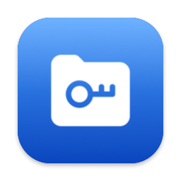
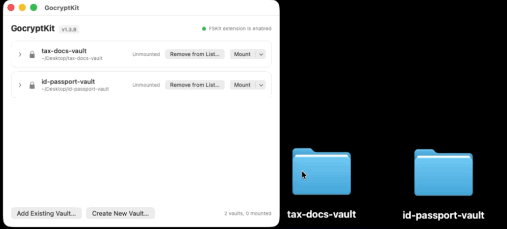
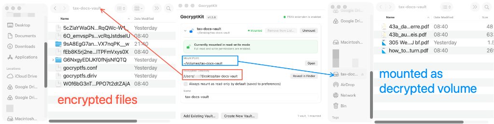
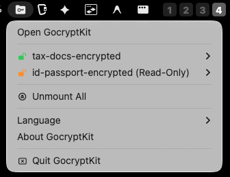
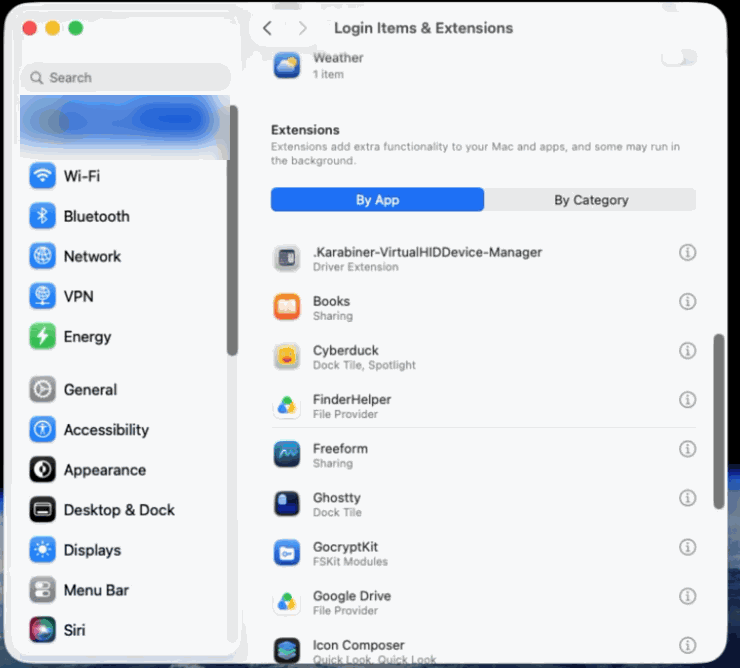
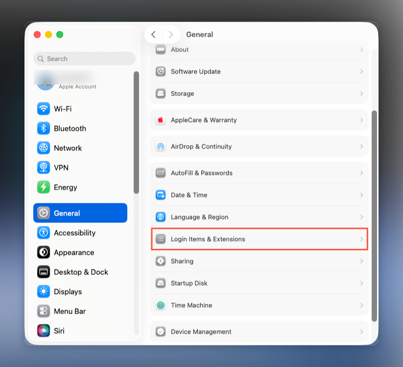
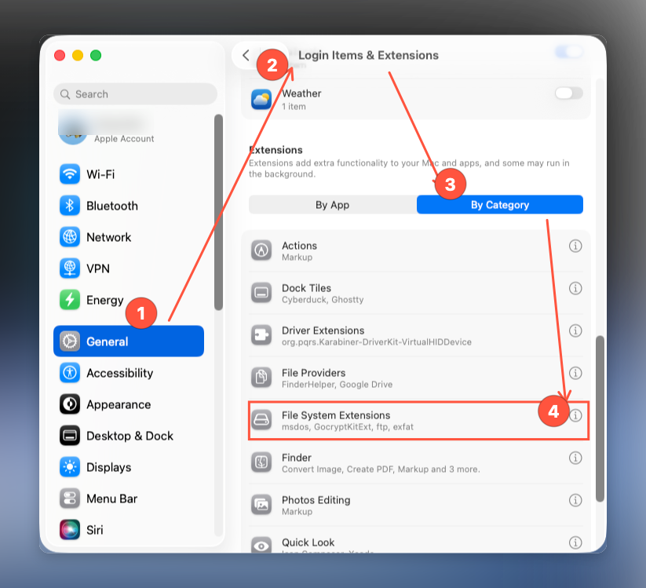

<p align="center">
  
</p>

<h1 align="center">GocryptKit</h1>

<p align="center">
  <b>在 macOS 上原生挂载 <a href="https://github.com/rfjakob/gocryptfs">gocryptfs</a> 加密卷，基于 Apple 现代原生 FSKit 用户态文件系统框架。</b>
</p>

<p align="center">
  <b>零 kext · 零 macFUSE · 零 sudo · 零安全降级</b><br>
  完整保持 SIP（系统完整性保护）开启 —— 无需进入 Recovery 降低安全性，无需 FUSE-T。
</p>

<p align="center">
  <a href="https://github.com/maxing-labs/GocryptKit/releases/latest"></a>
  
  
  <a href="https://github.com/maxing-labs/GocryptKit/releases/latest"></a>
  
  <a href="LICENSE"></a>
</p>

<p align="center">
  <a href="README.md"><b>🌐 English Documentation (README in English)</b></a>
</p>

---

<p align="center">
  
</p>

---

## 为什么选择 GocryptKit？

在 Apple Silicon (M系列) Mac 上挂载加密密卷或实现网盘文件端到端加密，以往用户面临着痛苦的抉择：
1. **传统 macFUSE / 内核扩展方案**：必须关机进入 macOS Recovery 恢复模式，将系统整机安全策略强制调低为**“降低安全性（Reduced Security）”**，严重破坏系统防线与稳定性，每次系统升级极易内核恐慌（Kernel Panic）。
2. **闭源商业壳软件**：作为敏感数据加密软件，核心代码闭源无法接受社区安全审计，存在后门隐患或商业格式绑架。
3. **整盘/镜像类加密方案（如 VeraCrypt、加密 DMG）**：只需修改其中 1 个小文件，数 GB 甚至几十 GB 的单一大文件镜像就必须在云盘（iCloud/OneDrive/Dropbox/坚果云）全量重新上传，冲突频发且消耗流量。

**GocryptKit** 为现代 macOS 量身打造：
- **完全零驱动**：采用 Apple 原生第一方 **FSKit**（用户态文件系统）框架，开箱即用。
- **单文件增量加密**：底层完全遵循经久验证的 [gocryptfs](https://github.com/rfjakob/gocryptfs) 开源标准，改动哪个文件就仅加密同步哪个文件。
- **100% 开源与严苛审计**：内存级密码即用即擦除（`memset_s`）、进程表口令零泄露、TLV 强校验安全凭据管道。

### 核心方案横向全景对比

| 方案 | 开源状态 | 读写支持 | 底层驱动架构 | 免降级系统安全 (保持SIP) | 网盘增量同步友善 (单文件加密) | 跨平台互通 (Linux / Android) |
| :--- | :---: | :---: | :---: | :---: | :---: | :---: |
| **GocryptKit (本项目)** | ✅ 100% 开源 (GPLv3) | ✅ 原生完整读写 | **Apple 原生 FSKit** | ✅ 完全保持开启 | ✅ 极佳 (gocryptfs 规范) | ✅ 完整支持 (Linux / DroidFS) |
| **macFUSE + gocryptfs** | ✅ 开源 | ✅ 完整读写 | 内核扩展 (`kext`) | ❌ 需进 Recovery 降级安全 | ✅ 极佳 | ✅ 完整支持 |
| **MyCryptFS** | ❌ 闭源商业软件 | ✅ 完整读写 | File Provider 机制 | ✅ 保持开启 | ✅ 极佳 | ⚠️ 格式兼容但代码闭源 |
| **Cryptomator** | ✅ 开源 | ✅ 完整读写 | FUSE-T / WebDAV | ✅ 保持开启 | ✅ 极佳 | ❌ 自定义专属格式 (非 gocryptfs) |
| **VeraCrypt** | ✅ 开源 | ✅ 完整读写 | 虚拟磁盘 + macFUSE | ❌ 需进 Recovery 降级安全 | ❌ 大文件变动全盘重传 | ✅ 完整支持 |
| **macOS 原生加密 DMG** | ⚠️ 系统内置 | ✅ 完整读写 | APFS 稀疏磁盘镜像 | ✅ 保持开启 | ❌ 易锁死 / 同步冲突 | ❌ 仅限 Mac |

---

## 特性与安全优势

<p align="center">
  
</p>

- **Apple 原生深度融合**：基于 macOS 现代 FSKit 用户态框架，解密卷如同内置硬盘一般直接在访达 Finder、终端及标准系统文件对话框中无缝读写。
- **高安全凭据防御机制**：
  - **即用即焚（Burn-after-reading）**：采用严格的 TLV 格式 Keychain 协议（`VCP1`），挂载成功后立即物理销毁临时传输凭据。
  - **内存强制清零**：在 C/Swift 核心边界，对 MasterKey、明文密码及 Scrypt 密钥派生缓冲区强制调用 `memset_s` 清零，杜绝密码残留于 Swap 交换区或崩溃日志。
  - **进程防泄露 CLI**：彻底移除 `--password <明文>` 命令行参数，杜绝口令暴露在 `ps` 进程列表或 `~/.zsh_history` 中（仅支持遮罩输入或 `--password-stdin` 管道）。
- **并发文件句柄物理隔离**：读、写文件描述符物理解耦并配备独立读写互斥锁，根除多线程密集读写竞争导致的内核 `EBADF` 异常。
- **原生扩展属性 (xattr)**：全面支持 macOS 颜色标签与元数据，加密采用 EME + DirIV (AES-GCM)，避免在网盘生成烦人的 `._*` AppleDouble 冗余垃圾文件。
- **状态栏与交互体验打磨**：
  - 菜单栏常驻图标随挂载状态动态反馈（解密挂载时切换为开锁形态 `lock.open.fill`）。
  - 卸载防重置灰、并发防死锁互斥，以及批量卸载遭遇 `EBUSY`（文件正被占用）时的集中合并诊断弹窗与一键强制卸载。
  - 优雅的纯原生 SwiftUI 客户端，内核挂载表实时同步（`getfsstat` 与 `NSWorkspace` 系统挂载通知）。

<p align="center">
  
</p>

---

## 下载与安装体验

**v1.4.2** — 准确的错误码，并汇总 v1.3.9 – v1.4.1 的安全与数据完整性修复（macOS Apple Silicon）

→ [前往 GitHub Releases 页面下载 GocryptKit-1.4.2.dmg](https://github.com/maxing-labs/GocryptKit/releases/tag/v1.4.2)

| 属性 | 参数 |
|---|---|
| 安装包 | `GocryptKit-1.4.2.dmg` |
| SHA-256 | `a9d9e51f0e42f87086457fce4b1b1b40f442666690ebed17f4aa1fbe75ff0931` |
| 芯片架构 | Apple Silicon (`arm64-only`) |
| 签名 | Developer ID Application（Team `QBFSP2CHNW`），**已签名、未公证** |

> **自 v1.3.9 起不再公证。** 维护者的 Apple Developer Program 会员已到期，v1.3.8 之后的版本仍用 Developer ID 证书签名，但没有 Apple 公证票据。首次打开时 Gatekeeper 会拦截：在「应用程序」里 **右键 `GocryptKit.app` → 打开**，或到 **系统设置 → 隐私与安全性** 点 **仍要打开**。其余一切（包括文件系统扩展）与以前相同。[v1.3.8](https://github.com/maxing-labs/GocryptKit/releases/tag/v1.3.8) 是最后一个公证版本，但它没有 [CHANGELOG-zh.md](CHANGELOG-zh.md) 里 v1.3.9 起的任何修复。

校验下载的安装包：

```bash
shasum -a 256 GocryptKit-1.4.2.dmg
# 把 App 拖进 /Applications 之后：签名必须有效，且属于 QBFSP2CHNW 这个 Team
codesign --verify --deep --strict --verbose=2 /Applications/GocryptKit.app
codesign -dv /Applications/GocryptKit.app 2>&1 | grep TeamIdentifier
```

---

## 快速上手

### 安装与首次授权

1. 下载并拖拽 `GocryptKit.app` 至「应用程序」文件夹（`/Applications`）。
2. 打开 `GocryptKit.app` 一次。由于安装包未经公证（见[下载与安装体验](#下载与安装体验)），首次打开会被 Gatekeeper 拦截：**右键 App → 打开**，或到 **系统设置 → 隐私与安全性** 点 **仍要打开**。
3. 开启文件系统扩展权限（仅首次需开启）：  
   **系统设置 → 通用 → 登录项与扩展 → 滚动到底部 → 文件系统扩展 → 将 GocryptKit 开关置为开启（ON）**。

<p align="center">
  
</p>

<p align="center">
  
  &nbsp;
  
</p>

4. 在应用主界面：
   - 点击 **“添加已有卷…”**：直接选择现有 gocryptfs 密文目录（如网盘同步盘目录或 Linux 既有卷）；
   - 点击 **“新建加密卷…”**：初始化一个全新的加密保险库。
5. 输入密码并点击 **“挂载”**，解密后的宗卷将即刻在访达 Finder 侧边栏和桌面上就绪！

### 命令行工具 (CLI)

应用 Bundle 内置了完整的 CLI 命令行工具，可无缝用于无头自动化脚本：

```bash
# 交互式初始化新加密卷（终端安全遮罩输入，无回显）
/Applications/GocryptKit.app/Contents/MacOS/GocryptKit init <目标空目录>

# 脚本自动化建卷（通过标准 stdin 管道传递密码）
echo "你的安全密码" | /Applications/GocryptKit.app/Contents/MacOS/GocryptKit init <目标空目录> --password-stdin

# 挂载加密卷
/Applications/GocryptKit.app/Contents/MacOS/GocryptKit mount <密文目录> <挂载点路径>

# 正常卸载 / 强制卸载加密卷
/Applications/GocryptKit.app/Contents/MacOS/GocryptKit umount <挂载点路径>
/Applications/GocryptKit.app/Contents/MacOS/GocryptKit umount -f <挂载点路径>

# 查看当前 FSKit 扩展运行状态
/Applications/GocryptKit.app/Contents/MacOS/GocryptKit status
```

> ⚠️ **安全须知**：为杜绝安全漏洞，已全量移除明文 `--password <密码>` 参数。脚本自动化任务请统一使用 `--password-stdin` 管道输入流。

---

## v1.4.2 最新更新摘要

v1.4.2 是 v1.3.8 之后的第一个公开版本，一次带来六个版本（v1.3.9 – v1.4.2）的安全与数据完整性工作：

- **数据完整性**：文件在打开期间被删除或被 rename 覆盖时，句柄保留到关闭为止。之后的写入不会再把已删除的文件“复活”，也不会写进接替它名字的文件（此前可能导致该文件重挂后无法读取）。两个并发的 `O_EXCL` 创建不会再同时成功。同一文件的多个句柄共享 file ID 和内容锁。
- **保护卷密钥**：`-plaintextnames` 卷的 `gocryptfs.conf` 不能再通过挂载卷被删除、被 rename 覆盖或被修改。
- **与上游 xattr 互通**：扩展属性名改用上游 gocryptfs 的固定 IV 加密，`gocryptfs -fsck` 和 Linux 版 gocryptfs 都能读。v1.3.9 及更早版本写入的属性照常可读，下次写入时自动转换。
- **被篡改的密文目录**：植入的超大扩展属性、滥用的 scrypt 参数、FIFO、指向已挂载卷的 `gocryptfs.conf` 符号链接、位于已挂载卷之内的卷，都会在让文件系统扩展崩溃或卡住之前被拒绝。
- **准确的错误码**：挂载卷如实报告遇到的错误（`EACCES`、`ENOENT`、`ENOSPC`、`ENOTEMPTY` 等），不再一律报 I/O 错误，备份和同步工具因此能正确处理。
- **文件属性**：修改、访问、创建时间和 flags 真正生效；拒绝设置追加专用标志（此前会让文件再也写不进去）；只读的新建文件对创建它的程序仍可写；拷贝 0444 文件不再失败。
- **命令行与钥匙串**：不认识的参数直接报错，`--password=…` 不再回显密码，挂载被中断时清除凭据，默认挂载根目录 `~/Volumes` 为 0700。
- **文本框**：所有文本框关闭了系统文本替换和内联预测，“显示密码”时不会再以你没有输入过的密码建卷。
- **退出**：只有你的卷都没挂着时应用才退出，并且只在强制卸载能让应用退出时才提供强制选项。

👉 **如需查阅完整的逐版本记录（v0.1.0 至 v1.4.2），请见 [CHANGELOG-zh.md](CHANGELOG-zh.md)。**

---

## 源码编译说明

### 系统与依赖要求

- **操作系统**：macOS 26.0+ (Apple Silicon)
- **编译工具链**：Xcode 26+、Go 1.25+、[XcodeGen](https://github.com/yonaskolb/XcodeGen)、`create-dmg`
- **测试工具**：`ffmpeg`（包含 libmp3lame 与 libx264）

### 编译步骤

```bash
git clone https://github.com/maxing-labs/GocryptKit.git
cd GocryptKit

# 1. 编译 Go 核心加密引擎 (darwin arm64 c-archive)
Engine/build-darwin.sh

# 2. 打包生成 XCFramework
Engine/make-xcframework.sh

# 3. 通过 project.yml 生成 Xcode 工程
xcodegen generate

# 4. 构建 Release 正式版应用程序
xcodebuild -project GocryptKit.xcodeproj -scheme GocryptKit \
  -configuration Release build
```

> **外部开发者须知**：  
> `project.yml` 内置了主创团队的发布签名配置。若在个人本地环境编译调试，请修改 `project.yml` 中的 `DEVELOPMENT_TEAM`，或直接在 Xcode Signing 界面切换为您个人的 Apple 开发团队。

### 打包发布 DMG

```bash
Scripts/build-dmg.sh
```

构建生成的安装镜像文件位于：`build/dist/GocryptKit-1.4.2.dmg`。

---

## 测试验证

```bash
# 不需要挂载的全部测试层：Go 引擎（go vet + go test -race）、VaultCore（156 项）、
# 扩展回调（45 项；--tsan 再在 Thread Sanitizer 下跑一遍）和宿主脚本。日志在 build/test-logs/<layer>.log。
Scripts/test.sh fast [--tsan]

# 真实挂载上的端到端测试（114 项）。需要 /Applications 里已装好 App 并启用扩展；
# 有任何 gocryptfs 卷挂着时拒绝启动。
Tests/e2e/make-samples.sh
Scripts/test.sh mount
```

---

## 开源协议与鸣谢

本项目采用 [GNU General Public License v3.0 (GPL-3.0)](LICENSE) 开源协议，并附带 **Apple App Store Exception (Version 1.0)** 例外商业授权。

底层加密引擎 `Engine/libgocryptfs` 衍生自上游开源项目 [gocryptfs](https://github.com/rfjakob/gocryptfs)，遵循 MIT 开源协议。

应用“文件夹与钥匙”视觉图标由 [Flaticon](https://www.flaticon.com/free-icon/folder_10303679)（图标 ID: `10303679`）设计，遵循 Flaticon Free 授权。详情参见 [`Art/ATTRIBUTION.md`](Art/ATTRIBUTION.md)。
